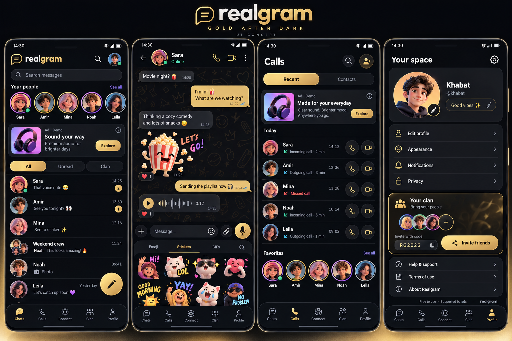

# Realgram — Gold After Dark

Approved visual direction, 23 October 2026. The user requested a dark, luxurious,
playful Gen Z messenger, with more personality than the previous navy preview.
The attached concept is the visual reference; the HTML playground is the
interactive reference. Both belong in the canonical Real-Gram/Realgram repository.

## Review and source

- Browser playground: https://setai.no/realgram/ (explicit user-requested review
  location; this does not rename the app or change its production domains).
- Implementation: `web-preview/realgram/index.html`, `style.css`, `app.js`.
- Approved reference: `docs/design/realgram-gold-after-dark.png`.
- Original generated illustration atlas:
  `web-preview/realgram/assets/people-and-stickers.png`.
- Native starting point: the existing messenger screens and separate preview
  in `mobile-app/src/preview/DesignPreviewApp.tsx`, not a new application rewrite.
- Continue from this feature branch, stacked on
  `feat/realgram-design-preview-20261023`. A later explicit request authorizes the separate 0.9.152-gold APK and public Live Lounge. See GOLD_APK_0.9.152.md.

## Design language

| Token | Value | Use |
| --- | --- | --- |
| Ink | `#090A0E` | Main dark surface |
| Charcoal | `#19191E` | Cards, composer, ad surface |
| Raised charcoal | `#222228` | Secondary surfaces |
| Champagne gold | `#E7C778` | Selected controls, unread badges, main actions |
| Gold button | `#FFE6A1 → #E4BD6E → #C49349` | Compose/send/invite and selected pills |
| Primary text | `#F5F1E8` | Names and body text |
| Secondary text | `#AAA9B4` | Previews, timestamps and supporting text |
| Lilac | `#B49AFF` | Avatar rings and secondary links |
| Mint | `#73DFBC` | Example presence, incoming indication |
| Coral | `#FF858F` | Missed calls |

Use a clean rounded sans-serif and a consistent family of 1.65–1.8 px line icons.
The luxury comes from contrast, hierarchy and a few gold actions, not gold borders
around every row. Use colorful 3D avatars, expressive stickers and small reactions
to add personality. Keep surfaces calm and text readable. Do not put animation
over the message body. Respect reduced motion. Do not animate every icon forever.

The HTML uses system fonts and local assets only. UI sizes are CSS pixels; carry
the visual proportions into React Native density-independent units and validate
on a physical phone. Circular icon buttons need accessible touch targets even
when their visible icon is small. Main content must avoid cutouts and navigation
insets. All tap actions need a visible outcome and screen-reader labels.

## Screens and behavior

1. **Chats:** compact Realgram header, search, colorful people row, one clearly
   labeled ad card above the log, All / Unread / Clan filters, compact conversation
   rows with subtle separators, readable times, gold unread counts, gold compose.
   Avoid huge boxed rows and excessive empty padding. Search filters example
   contacts and message text. Opening a conversation clears its example unread
   badge. The Clan filter refers to the example group, not a game.
2. **Conversation:** compact identity header, audio/video controls, subtle dark
   doodle wallpaper, charcoal incoming bubbles and warm gold outgoing bubbles
   with dark readable text. Support stickers, emoji reactions, a voice waveform
   and a bottom composer. Sticker / Emoji / GIFs drawer should feel tactile and
   fun. Actual GIF/media service, recording, attachment upload and codecs are
   separate integration work: do not label static/visual previews as working
   media. The web prototype records or plays no audio and sends no messages.
3. **Calls:** Recent / Contacts, a compact labeled ad directly above the call log,
   avatars, clear incoming/outgoing/missed states, time/duration and separate
   audio/video actions. Favorites below. Only show Online/durations as actual
   facts once backed by real presence/call state; the browser fixtures explicitly
   label example states. Call buttons open a visual preview, without calling.
4. **Profile:** expressive identity card, name/handle/status, compact icon rows
   with chevrons for profile/appearance/notifications/privacy, then a clan card.
   Local name/status editing works for the current browser page session. Help,
   terms and about are explanatory prototype dialogs, not production policies.
5. **Clan:** invitation-focused social area with overlapping avatars, invite
   card/code and example friends. No game access, game economy or paid tier.
   `RG2026` is fictional, labeled non-redeemable, and only copies an example code.
6. **Connection:** quiet gold/dark screen with example disconnected/connected
   visuals. Native integration must retain honest loading/error/retry states;
   showing a gold connected icon does not establish a tunnel or network quality.

Bottom navigation: **Chats · Calls · Connect · Clan · Profile**. Preserve this
order across screens and translations. The active item is gold; inactive items
remain legible. In the HTML, a narrow open conversation hides the global tabs
and provides an explicit back action; wide layouts keep the master/detail shell.

## Ads and free use

- The banner belongs above the conversation or call log, below navigation/search
  or filters where appropriate. Keep it visually distinct from actual messages.
- Clear Ad label and information control, one advertiser image, short copy and
  a distinct CTA. Reserve predictable space and avoid jumps as content loads.
- The prototype card is explicitly **Ad · Demo**. Its CTA opens an explanatory
  dialog. No SDK, ad requests, impressions, earnings or clicks are recorded.
- In the native app, retain SDK-provided ad attribution/disclosure/AdChoices
  and verify impression callbacks when the ad is really visible. Do not infer
  revenue from loading, a demo click or animation. Validate the intended native
  placement and platform policy before replacing the current banner component.
- Realgram remains free and ad-supported: no subscriptions, purchases, VIP or
  payment screens. Do not turn decorative gold into a paid status symbol.

## Responsive and implementation boundaries

- Under 800 CSS px: one primary pane; full-height mobile layout with safe-area
  padding, sticky composer and bottom navigation. Test at 360/390/430 widths.
- At 800+ px: Chats has a 390 px master list and flexible conversation pane.
  Other primary screens stay within a readable 700 px column. This supports an
  unfolded device without stretching every profile action across the display.
- The HTML is dependency-free and buildless. No cookies, analytics, localStorage or contacts access. Private design changes reset on reload; the public Live Lounge uses the dedicated community endpoint and retains recent messages for up to seven days.
- All dynamic user text is HTML-escaped before rendering. Keep that boundary.
- Do not replace the screenshot with an image-map: native and web controls must
  remain real text, icons, rows, buttons and lists.
- This review location is not a production app/domain migration. Keep canonical
  production URLs and the existing Android installation identity/release signer.
- API auth, Firebase background ringing, original signing and Play activation
  remain separate unresolved work. The existing APK is not rebuilt by this task.

## Illustration atlas

The local PNG is an original generated 5-column × 2-row sprite atlas. Top row:
Sara, Amir, Mina, Noah, Leila. Bottom row: Khabat, headphones, popcorn, heart cat,
sun. It contains fictional characters, not the private contact photos from the
user's Viber screenshots. CSS uses `background-size:500% 200%`, x positions
0/25/50/75/100 percent, y 0/100 percent. Keep the original file; export standalone
native assets only when integrating. Gold doodle wallpaper and icons are SVG/CSS.

## Acceptance for the next native implementation

- Match the approved color/spacing/identity hierarchy on a phone and Fold width.
- Chats/calls have a single clearly labeled ad above the relevant log.
- All five tabs, search/filters, compose, reactions, profile edit and clan actions
  have actual working states or honestly labeled unavailable integration states.
- No game or payment navigation/imports return. No paid gate on calling.
- Existing translations/RTL and native accessibility/safe areas remain supported.
- Do not replace real profile data/messages with the HTML fixtures in normal builds.
- Run the existing naming/import guards, relevant mobile tests, TypeScript and
  a bundled preview check before requesting a new APK. Native build/signature and
  phone checks are additional requirements, not established by this HTML.
